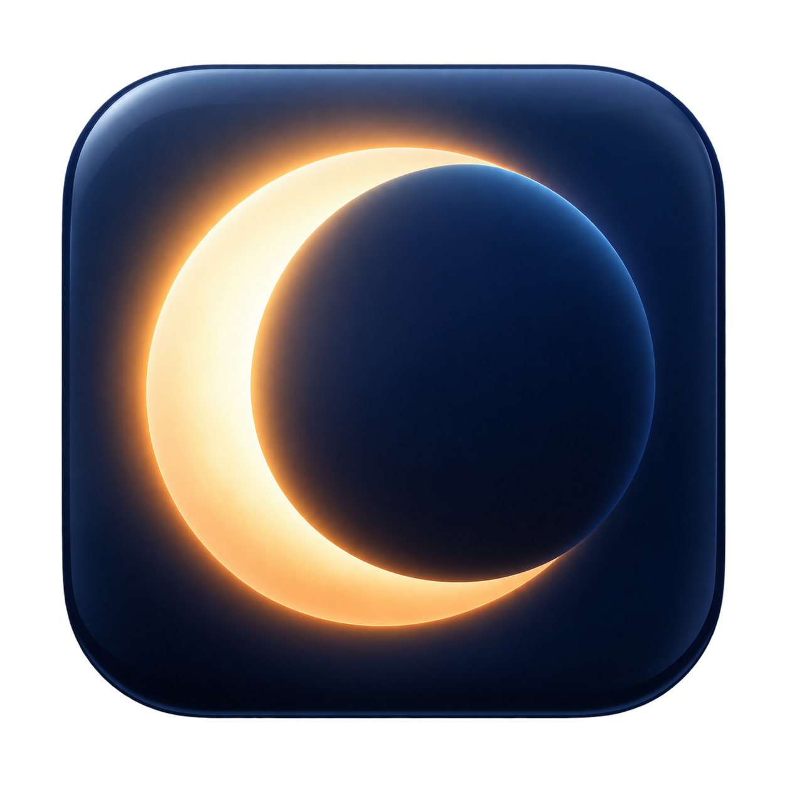

# Luma



[MIT licensed](LICENSE) · Native SwiftUI · Apple silicon

A native macOS background utility that switches the **whole system appearance** according to your MacBook’s ambient light sensor. Built for Apple silicon; macOS 13 or later. No account, network connection, administrator privileges, or kernel extension required.

## Run

Build the app using the instructions below, then open `../Luma.app` to show its settings. Luma has no menu-bar or Dock icon. Close the settings window to keep automatic switching running in the background; open Luma.app again from Finder or Spotlight whenever you want to adjust it. Launch at login stays hidden. Use **Quit Luma** in settings to stop the app.

Automatic switching starts enabled. Defaults:

- **Dark** after the reading stays below **40 lux** for **10 seconds**.
- **Light** after it stays above **80 lux** for **10 seconds**.
- Keep the current appearance between those thresholds.

Adjust both thresholds and the waiting period in Settings. Readings are sampled every two seconds, so transitions occur on the next sample after the waiting period. Enable **Launch at login** if wanted; approve the login item in System Settings if macOS requests it. Keep the app in a stable location when using launch at login; disable that option before moving it, then re-enable afterwards.

macOS may ask to let Luma control **System Events**. This allows the app to set system appearance. If denied, Luma pauses and shows recovery instructions for System Settings → Privacy & Security → Automation. It does not request Accessibility or Input Monitoring permission.

While automatic switching is active and the sensor is available, Luma suspends macOS’s time-based Auto appearance schedule to prevent competing changes. It remembers whether Auto was enabled and restores it when automatic switching is paused or Luma quits normally. After a crash, reopen Luma and pause or quit to restore the saved schedule. Quitting leaves the current light/dark appearance in place.

**Light** and **Dark** appearance cards pause Luma’s automatic switching. Choose **Auto** to resume, or use the settings controls. Enter exact lux values in the number fields and press Return, or use the sliders. The sliders use a logarithmic scale to make low-light adjustments easier. The info button explains how switching works. Your previous macOS Auto schedule, if any, resumes while Luma is paused.

## Behaviour and compatibility

- Real sensor readings in lux; no camera access or brightness estimation.
- Missing/invalid readings never count as darkness. The current appearance is retained and the sensor is retried.
- Sleep, inactive sessions, a closed lid, or a long sampling gap cancel pending changes. Wake starts a fresh waiting period.
- Separate thresholds and a continuous waiting period prevent flicker near a threshold or from a brief shadow.
- Settings are stored locally in `local.lightsaber.Luma` preferences. There is no telemetry.
- Sensor access uses private Apple BezelServices/IOKit APIs loaded dynamically. This is intended as a personal local utility, not an App Store extension. A future macOS update can break sensor access; if that happens the app reports the sensor as unavailable. Legacy Intel sensors and sensors in external displays are not implemented.
- The app is locally ad-hoc signed, not notarised for distribution to other Macs. The included build targets the architecture of the Mac running the build.

## Build and test

Requires Xcode 26 or later with the macOS 26 SDK or later, including its command-line tools. The app deployment target is macOS 13; building the Liquid Glass interface requires the newer SDK. There are no third-party package dependencies.

```sh
git clone https://github.com/RT-bit-cyber/Luma.git
cd Luma
./build.sh
CLANG_MODULE_CACHE_PATH="$PWD/.build/clang-cache" swift test --disable-sandbox
../Luma.app/Contents/MacOS/Luma --sensor-check
open ../Luma.app
```

`--sensor-check` reads the sensor once without starting the background app, changing appearance, or writing preferences. A tool sandbox can hide the sensor even when the launched app reads it successfully.

Open `Package.swift` in Xcode to edit the source. Use `build.sh` to produce the app bundle with the usage description and signing entitlement needed for Apple Events. Quit the app from its settings window before rebuilding it. `build.sh` writes `../Luma.app` by default. Set `LUMA_APP_PATH` to choose another output, for example `LUMA_APP_PATH="$PWD/dist/Luma.app" ./build.sh`.

Tests cover both switching directions, a real zero reading, shadows and the neutral band, missing/invalid samples, a sleep-sized gap, exact boundaries, and invalid configuration.

## Remove

Turn off **Launch at login**, then quit Luma and move `Luma.app` to the Bin. The source folder can also be removed. Luma restores the previous macOS Auto schedule when it quits normally.

## References

Sensor ABI research: [DarkModeBuddy by Guilherme Rambo](https://github.com/insidegui/DarkModeBuddy/blob/main/DarkModeBuddyCore/Source/AmbientLight/DMBAmbientLightSensor.m). This project implements its own sensor wrapper, policy and interface.

System appearance is set through the installed System Events scripting dictionary and [NSAppleScript](https://developer.apple.com/documentation/foundation/nsapplescript). Apple's [appearance guide](https://support.apple.com/en-ie/guide/mac-help/mchl52e1c2d2/mac) documents that built-in Auto follows the Night Shift schedule.

## Interface and icon

The interface adapts to light and dark appearance, with a live sensor dial and Auto / Light / Dark selection. Your existing thresholds and login setting are preserved. The eclipse app icon is bundled in sizes from 16 to 1024 pixels. The original generated PNG is in `Resources/LumaIcon.png`; its generation prompt is in `Design/Icon-prompt.md`.

The settings window uses a compact layout up to 440 × 600 logical points, plus its title bar. It fits the current display’s visible bounds whenever it opens, and scrolls vertically when the screen is smaller or additional messages are shown.

The settings window uses native Liquid Glass on macOS 26 and later, with a translucent material fallback on earlier supported systems. Reduce Transparency is respected with an opaque background. Inner control panels use subtle translucent fills so the main glass surface remains visible.

## Contributing

Bug reports and pull requests are welcome. Include your macOS version, Mac model, and steps to reproduce the problem. For sensor problems, include the output of `--sensor-check`; do not post personal logs or account details. See [CONTRIBUTING.md](CONTRIBUTING.md) for the development workflow.

## Licence

Luma's source code and bundled assets are provided under the [MIT licence](LICENSE). The eclipse icon was generated with OpenAI image generation. Sensor ABI research is credited above; Apple frameworks remain subject to their own terms.
